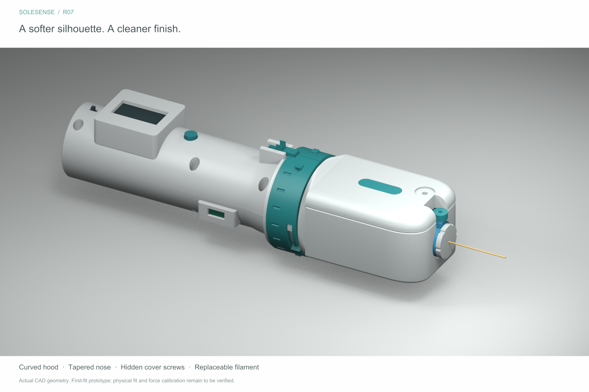

# SoleSense

Shared workspace for the SoleSense handheld tactile-testing prototype: editable 3D models, print files, build documentation, sensing studies, videos, and future device software.

**Current design: [R07 — sculpted magnetic pressure head](revisions/R07/README.md).**



The device explores interchangeable pressure and vibration heads, a replaceable nylon filament cartridge, and a larger 1.3-inch display. The current pressure head uses metal leaf springs, a moving magnet, and a fixed Hall sensor to infer force from calibrated displacement.

## Start here

| You want to… | Open |
| --- | --- |
| Download the current build package | [R07 ZIP](revisions/SoleSense_R07_Print_and_Build.zip) · [GitHub release](https://github.com/mustafamoe/sole-sense/releases/tag/design-r07) |
| Edit the 3D design | [FreeCAD model](revisions/R07/cad/SoleSense_R07.FCStd) · [CAD and STEP files](revisions/R07/cad/) |
| View the assembled device in another CAD tool | [Full STEP assembly](revisions/R07/cad/SoleSense_R07_Pressure_Assembly.step) |
| Print parts | [Print-first coupons](revisions/R07/print_first/) · [37 individual STLs](revisions/R07/stl/) · [Six 3MF plates](revisions/R07/print_plates/) |
| Build the prototype | [Build guide](revisions/R07/docs/BUILD_GUIDE.md) · [Shopping list](revisions/R07/docs/SHOPPING_LIST.md) · [Print-shop brief](revisions/R07/docs/PRINT_SHOP_BRIEF.txt) |
| Understand the mechanism | [Inside the head](revisions/R07/previews/02_Inside_Head.png) · [Cartridge service](revisions/R07/previews/03_Assembly_Service.png) |
| Work on electronics or calibration | [Wiring and calibration](revisions/R07/docs/WIRING_AND_CALIBRATION.md) · [Calibration log template](revisions/R07/docs/calibration_log_template.csv) |
| Start firmware or companion software | [Firmware workspace](firmware/) · [Software workspace](software/) |

Use R07 parts **41, 42, 43 and 55 together**; the decorative inlay 56 is optional. Begin with fit coupons. The 3MF plates contain geometry only: choose the actual printer and material profile before slicing.

## Status

This is a **first-fit bench prototype**. Recorded CAD geometry, movement, mesh and export checks are in [R07 validation](revisions/R07/validation/). Physical printing, component fit and force calibration remain outstanding.

- **1, 10 and 75 gf are intended force targets**, not demonstrated measurement accuracy.
- Current Hall sensing uses external bench electronics. Built-in head electrical contacts remain an unfinished concept.
- The nylon filament is an unrated geometry reference.
- Firmware and companion software are not implemented yet; their folders provide a starting point for the team.

See the [engineering notes](revisions/R07/docs/ENGINEERING_NOTES.md) for assumptions and remaining work.

## Videos and design history

- **[Final R07 head — assembly and magnetic sensing, 60 seconds](revisions/R07/video/README.md)**: exploded parts, assembly, cartridge locking, press/release cutaway and magnet/Hall close-up.
- [Head swapping and cartridge replacement — R04 video](revisions/R04/video/SoleSense_R04_Showcase.mp4)
- [Four sensing approaches — narrated comparison](concepts/C03_Sensing_Alternatives/video/SoleSense_Four_Sensing_Designs.mp4)
- [Magnetic sensing concept — short video](concepts/C03_Sensing_Alternatives/video/02_Magnetic_Flexure.mp4)
- [Flexure concept](concepts/C01_Flexure_Pressure_Head/) · [Kuuleyn load-cell concept](concepts/C02_Kuuleyn_Pressure_Head/) · [Sensing alternatives](concepts/C03_Sensing_Alternatives/)
- Previous designs: [R06](revisions/R06/) · [R05](revisions/R05/) · [R04](revisions/R04/) · [R03](README_R03.md)

The R07 video uses the final enclosure geometry. The R04 and concept videos show earlier designs. All motion is explanatory and does not establish sensor performance. Older documents preserve the decisions made at that time. Use the R07 guide for the current build.

## Repository layout

| Location | Contents |
| --- | --- |
| `revisions/R07/` | Current CAD, print files, images, documentation, source scripts and recorded checks |
| `revisions/R04/`–`R06/` | Previous design revisions |
| `revisions/*.zip` | Self-contained R05, R06 and R07 build packages |
| `concepts/` | Alternative sensing studies, editable scenes and explanatory videos |
| `firmware/` | Future device firmware |
| `software/` | Future calibration tools and companion software |
| `source_documents/` | Original hardware brief and connector reference |
| Root `cad/`, `stl/`, `docs/`, `source/`, `previews/`, `print_plates/`, `reference/`, `validation/` | Original R03 material retained in place |

The root package manifests and checksum files describe historical R03 exports, not this evolving Git repository. Release ZIPs carry their own package metadata. Reference meshes and complete assemblies are for review; print individual parts.

## Working together

Clone with:

```sh
git clone git@github.com:mustafamoe/sole-sense.git
cd sole-sense
```

Use branches and pull requests for changes, and GitHub Issues for build problems or tasks. Read [CONTRIBUTING.md](CONTRIBUTING.md) before changing a released design. No Git LFS setup is required for this initial repository.
