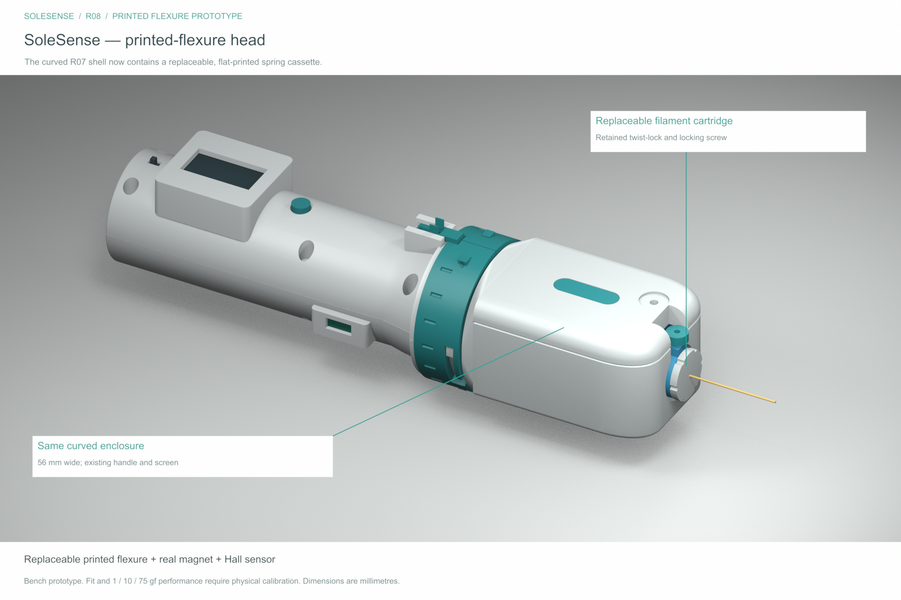

# SoleSense

Shared workspace for the SoleSense handheld tactile-testing prototype: editable 3D models, print files, build documentation, sensing studies, videos, and future device software.

**Current design: [R08 — replaceable printed-flexure pressure head](revisions/R08/README.md).**



The device explores interchangeable pressure and vibration heads, a replaceable nylon filament cartridge, and a larger 1.3-inch display. The current pressure head uses a replaceable printed spring cassette, a moving magnet, and a fixed Hall sensor to infer force from calibrated displacement.

## Start here

| You want to… | Open |
| --- | --- |
| Download the current build package | [R08 ZIP](revisions/SoleSense_R08_Print_and_Build.zip) · [GitHub release](https://github.com/mustafamoe/sole-sense/releases/tag/design-r08) |
| Edit the 3D design | [FreeCAD model](revisions/R08/cad/SoleSense_R08.FCStd) · [CAD and STEP files](revisions/R08/cad/) |
| View in another CAD tool | [Full STEP assembly](revisions/R08/cad/SoleSense_R08_Pressure_Assembly.step) |
| Print parts | [Print-first parts](revisions/R08/print_first/) · [35 individual STLs](revisions/R08/stl/) · [Six 3MF plates](revisions/R08/print_plates/) |
| Build the prototype | [Assembly video](output/video/SoleSense_R08_Assembly_Guide.mp4) · [Illustrated assembly PDF](output/pdf/SoleSense_R08_Head_Assembly_Guide.pdf) · [Build guide](revisions/R08/docs/BUILD_GUIDE.md) · [Shopping list](revisions/R08/docs/SHOPPING_LIST.md) · [Print-shop brief](revisions/R08/docs/PRINT_SHOP_BRIEF.txt) |
| Understand the mechanism | [Inside the head](revisions/R08/previews/02_Inside_Head.png) · [Exploded cassette](revisions/R08/previews/03_Exploded_Cassette.png) · [Printed flexure](revisions/R08/previews/04_Printable_Cassette.png) |
| Work on electronics or calibration | [Wiring and calibration](revisions/R08/docs/WIRING_AND_CALIBRATION.md) · [Calibration log](revisions/R08/docs/calibration_log_template.csv) |
| Start device software | [Firmware workspace](firmware/) · [Software workspace](software/) |

Use R08 **chassis 42, carriage 44, bridge 55 and ONE cassette 57/58/59 together**. The three beam widths (0.8/1.0/1.2 mm) are test alternatives, not force ratings. The real magnet, Hall sensor and fasteners remain. Start with coupons and inspect the beam toolpaths. 3MF files contain geometry only.

## Status

This is an **experimental bench prototype**. [CAD checks](revisions/R08/validation/) pass for solids, exports, sampled travel, all cassette variants, service access and retained interfaces. Physical printing, fit, plastic creep/fatigue and force calibration remain outstanding.

- **1, 10 and 75 gf are intended force targets**, not demonstrated accuracy. A soft cassette may bottom out before 75 gf; select and calibrate based on bench results.
- Initial Hall sensing uses external electronics. Built-in head electrical contacts remain unfinished.
- The nylon filament is an unrated geometry reference; firmware is not implemented.
- The earlier buying spreadsheet is not a fully matched BOM. R08 changes the spring system; other board/display/part-fit mismatches still need reconciliation.

See [engineering notes](revisions/R08/docs/ENGINEERING_NOTES.md) and [R07 → R08 changes](revisions/R08/docs/R08_CHANGES.md).

## Assembly and printing

- [R08 assembly video, 4:43](output/video/SoleSense_R08_Assembly_Guide.mp4) and [illustrated assembly PDF](output/pdf/SoleSense_R08_Head_Assembly_Guide.pdf): numbered parts, hardware inventory, screw directions, bridge removal, sensor orientation and bench checks.
- [Assembly guide sources](guides/R08-head-assembly/README.md): editable scenes, narration and production scripts.
- [Prepared R08 print projects](printing/R08/README.md), [fine-finish settings](printing/R08/fine_finish/README.md), [optimized orientations](printing/R08/orientation_optimized/README.md) and [replacement-part plate](printing/R08/reprint_skipped/README.md).

## Repository layout

| Location | Contents |
| --- | --- |
| `revisions/R08/` | Current CAD, print files, images, documentation, source scripts and recorded checks |
| `revisions/SoleSense_R08_Print_and_Build.zip` | Self-contained R08 build package |
| `printing/R08/` | Prepared print projects, layouts and slicing records for R08 |
| `guides/R08-head-assembly/` | Illustrated assembly guide sources and assets |
| `output/` | R08 assembly video, subtitles and PDF |
| `firmware/` | Future device firmware |
| `software/` | Future calibration tools and companion software |
| `source_documents/` | Original hardware brief and connector reference; not a matched R08 bill of materials |

R08 is the only standalone device revision kept in the working tree. Earlier revisions and concept studies remain available in Git history. The source dependencies inside `revisions/R08/source/dependencies/` supply retained geometry and a comparison baseline needed by R08's build and checking scripts; they are not separate current build options.

The R08 ZIP carries its own package metadata. Reference meshes and complete assemblies are for review; print individual parts.

## Working together

Clone with:

```sh
git clone git@github.com:mustafamoe/sole-sense.git
cd sole-sense
```

Use branches and pull requests for changes, and GitHub Issues for build problems or tasks. Read [CONTRIBUTING.md](CONTRIBUTING.md) before changing a released design. No Git LFS setup is required for this initial repository.
