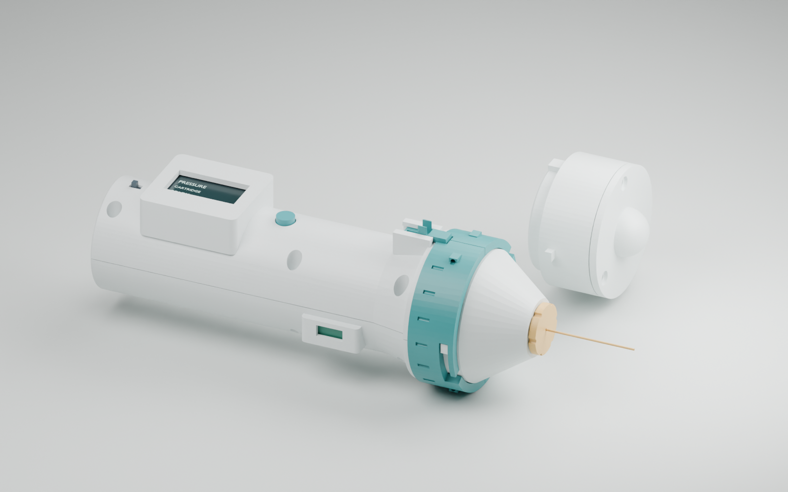

# SoleSense R04 — interchangeable heads and manual filament cartridge

An editable review prototype made on 19 October 2026. The original R03 package is preserved.

The teal collar releases either head using a sliding safety lock and a 30° turn. The head remains stationary so its proposed built-in contacts stay aligned. The pressure head holds one exposed filament in a small cartridge that can be changed by hand. The display enclosure is enlarged for a 1.3-inch OLED.

**Review prototype:** contact hardware is provisional, force is uncalibrated, and patient-contact materials and hygiene are not validated. The pressure mode is manual; it has no force measurement or automatic contact detection.

- [Animated walkthrough: head and cartridge swaps](video/SoleSense_R04_Showcase.mp4)
- [Video chapters and animation source](video/README.md)
- [Design decisions, operating concept and unresolved details](docs/DESIGN_REVIEW.md)
- [Native FreeCAD design](cad/SoleSense_R04.FCStd)
- [Editable Blender review](cad/SoleSense_R04_Review.blend)
- [Labeled exploded view: swap either head](previews/06_Exploded_Head_Swap_Labeled.png)
- [Labeled exploded view: replace the cartridge](previews/07_Exploded_Cartridge_Labeled.png)
- [Editable exploded guides](cad/SoleSense_R04_Exploded_Guides.blend)
- [Head exchange](previews/02_Head_Swap.png)
- [Replaceable filament cartridge](previews/03_Cartridge_Replacement.png)
- [Stationary contact layout](previews/04_Stationary_Contacts.png)
- [Larger display](previews/05_Larger_Display.png)

Pressure configuration: 224.4 mm long, versus 270.3 mm previously. Vibration configuration: 185.3 mm. Grip: Ø46 mm. Main collar: Ø62 mm. Display aperture: 30.4 × 15.8 mm.

The separate head assemblies and individual STEP/STL parts are in `cad/` and `stl/`. Validation reports are in `validation/`. Physical fit, retention, electrical operation, calibration and cleaning still require bench development.
