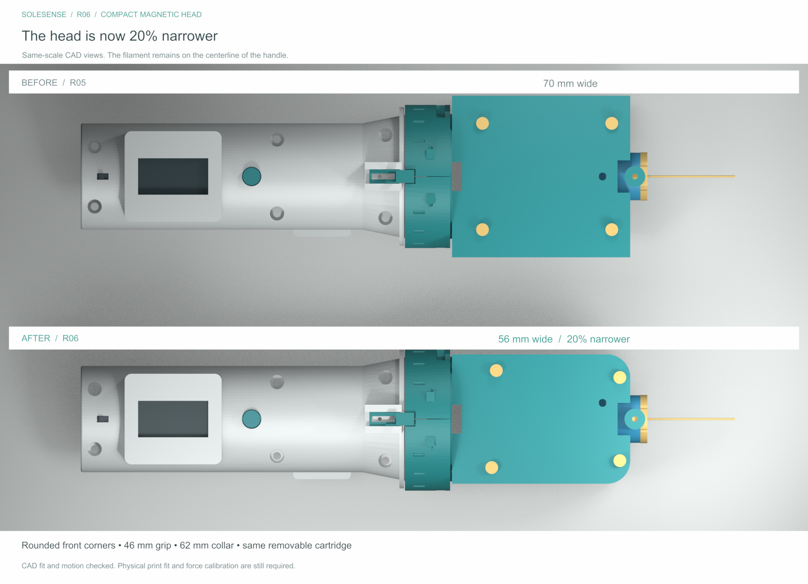

# SoleSense R06 — slimmer magnetic pressure head

20 October 2026 · First-build mechanical prototype

R06 reduces the main pressure-head width from **70 mm to 56 mm (20%)** and adds **10 mm rounded front corners**. It is narrower than the 62 mm twist-lock collar, though still 10 mm wider than the 46 mm grip. The tip stays centered; the handle and overall length are unchanged. The same springs, magnet, sensor and purchased fasteners are used.

The sensor/spring stage moves 7 mm sideways inside the enclosure. Revised parts 41, 42, 43, 44 and 55 must be printed together; use this revision’s print plates rather than mixing these parts with R05. See [what changed](docs/R06_CHANGES.md).

The pressure head now uses **two clamped metal leaf springs, a moving 6 × 3 mm magnet, and a stationary DRV5055 Hall sensor**. The cartridge and magnet move together. Electronics map the sensor output to force after calibration.

The housing opens from above. The model includes an adjustable sensor mount, mechanical travel stops, a removable service lock, a positively locked filament cartridge, a rigid bench-calibration cartridge, and print-first fit coupons. The existing R04 mechanical twist-lock, larger display enclosure and vibration-head geometry are retained.

**Start with [BUILD_GUIDE.md](docs/BUILD_GUIDE.md), then print [plate 01](print_plates/01_Print_First.3mf).** Printer and material were not specified, so the files assume a 0.4 mm FDM nozzle and a PLA bench build. The plates contain geometry only; they need the actual printer profile and support review.

- [Parts to order](docs/SHOPPING_LIST.md)
- [Assembled view](previews/01_Assembled.png)
- [Inside the head](previews/02_Inside_Head.png)
- [Assembly and cartridge service](previews/03_Assembly_Service.png)
- [Native FreeCAD model](cad/SoleSense_R06.FCStd)
- [Magnetic-head STEP assembly](cad/SoleSense_R06_Magnetic_Head_Assembly.step)
- [Full pressure-device STEP assembly](cad/SoleSense_R06_Pressure_Assembly.step)
- [Editable Blender review](cad/SoleSense_R06_Review.blend)
- [Wiring and calibration](docs/WIRING_AND_CALIBRATION.md)
- [Engineering assumptions and checks](docs/ENGINEERING_NOTES.md)

Print plates 01–03 cover the new head, coupons and accessories. Plates 04–06 contain retained handle/vibration parts if those have not already been printed. Individual STLs are in `stl/`, in millimetres with the bottom at Z=0. Never print an assembled STEP as one fused part.

This is a completed CAD package for **first-fit printing and bench development**, not a tested production or patient-use release. There is no physical fit test, force calibration, fatigue test, validated hygiene process or firmware in this package. The earlier built-in spring-contact connection remains an unfinished R04 concept; the new head has a cable exit for initial external bench electronics. Its mechanical twist-lock still fits the R04 geometry. Supplier listings do not confirm delivery for 21 October.

The CAD and STL geometry checks pass, including clearances through the modeled travel, spring clearances, cartridge exchange and collar operation. They do not establish accuracy at 1, 10 or 75 gf. The nylon shown is an unrated geometry reference; a filament's buckling limit must be checked separately.

Original R03–R05 and C01–C03 files remain available. The regeneration source includes the R04 inputs used to build this revision and R05 CAD/meshes used for comparison checks and imagery.
