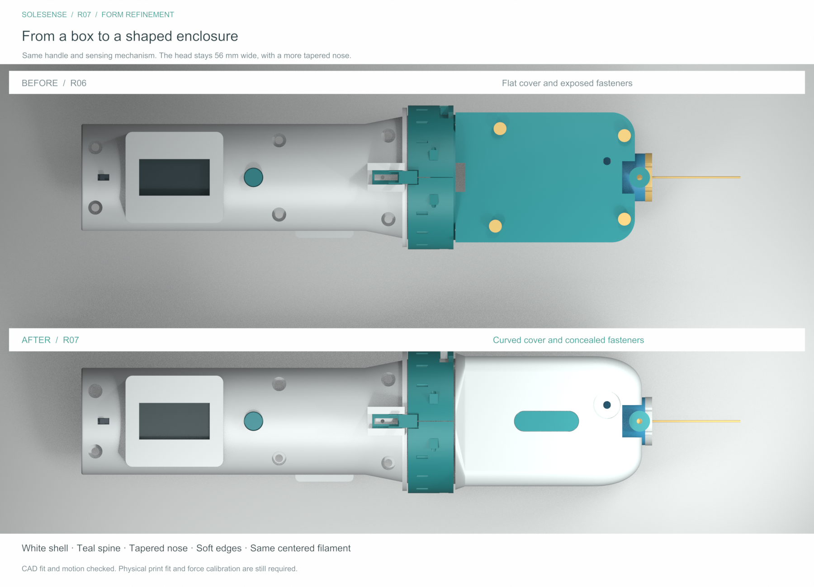

# R07 — enclosure form and finish

The head now has a curved white cover with 7 mm shoulders, 2 mm lower edge rounds, a fine perimeter seam, a narrow teal crown inlay and a front contour that tapers to 28 mm across the end face. A lofted adaptor blends the round collar into the enclosure. These are CAD features present in the STEP and print meshes.

The four cover screws move to the underside. Their heads sit in recesses in the chassis; their nuts sit in pockets under the cover. The service-pin opening remains visible on top, and the cartridge lock remains reachable through the nose notch. The service screw is fitted only during servicing.

| Dimension or hardware | R06 | R07 |
|---|---:|---:|
| Main housing width | 56 mm | 56 mm |
| Main housing length | 73 mm | 76 mm |
| Housing height including cover | 38 mm | 44 mm |
| Front end-face width | 36 mm | 28 mm |
| Cover edge radius | Square upper edge | 7 mm |
| Adaptor maximum width/height | 56 × 54 mm envelope | 59 × 59 mm envelope |
| Cover screws | 4 × M3 × 10 from top | 4 × M3 × 35 from underside |
| Service pin | M3 × 25 | M3 × 30 |
| M3 nut total including bridge | 12 | 14 |
| Centered filament / overall length | Y=0 / 283.4 mm | Y=0 / 283.4 mm |

The taller crown and slightly longer housing create the shaped exterior; the main body has not become narrower than R06. The grip remains Ø46 and the collar Ø62. The rear, near-circular face of the adaptor is within the collar envelope; its forward face transitions to the head. The main housing is 56 mm wide.

Reprint **41 adaptor, 42 chassis, 43 cover and 55 bridge** together. Add **56 inlay** for the teal accent. The moving carriage, spring strips and seats, Hall gap, cartridge and both travel limits retain R06 geometry. The service knob has the same local geometry but now fits the longer screw. Reuse unbonded parts only after fit inspection.

The optional inlay has 0.2 mm edge clearance and a 0.1 mm adhesive gap. Bond with a thin compatible adhesive film after fit checking. No seal or structural function is claimed for the inlay or perimeter seam.

The complete assembled head still requires physical fit, free-return and force calibration checks. CAD geometry does not establish strength, accuracy or hygiene performance.
