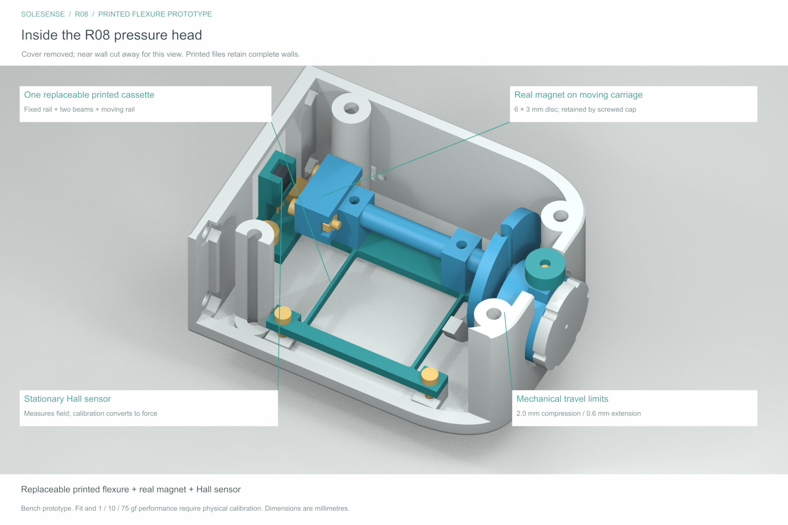

# SoleSense R08 — replaceable printed flexure

The magnetic pressure head now uses **one flat printed spring cassette** instead of two metal leaves and four clamps. The cassette combines a fixed rail, two flexible beams and a moving rail. Four M2 × 8 screws attach it to the housing and carriage.

The curved cover, tapered nose, manual filament cartridge, mechanical head twist-lock and larger display are retained. The housing remains **76 × 56 × 44 mm**. The real 6 × 3 mm magnet, DRV5055A3QLPG Hall sensor, electrical components and specified fasteners are still required.

| Task | Files |
|---|---|
| Edit | [FreeCAD model](cad/SoleSense_R08.FCStd) · [CAD-derived Blender review](cad/SoleSense_R08_Review.blend) |
| Inspect in another CAD program | [Head STEP](cad/SoleSense_R08_Magnetic_Head_Assembly.step) · [Device STEP](cad/SoleSense_R08_Pressure_Assembly.step) |
| Print | [Individual STLs](stl/) · [Print-first parts](print_first/) · [Geometry-only 3MF plates](print_plates/) |
| Assemble | [Build guide](docs/BUILD_GUIDE.md) · [Exploded cassette](previews/03_Exploded_Cassette.png) |
| Order parts | [Updated head shopping list](docs/SHOPPING_LIST.md) |
| Test | [Wiring and calibration](docs/WIRING_AND_CALIBRATION.md) · [Engineering notes](docs/ENGINEERING_NOTES.md) |
| Review changes | [R08 changes](docs/R08_CHANGES.md) · [Recorded CAD checks](validation/) |

The STEP assemblies contain the printable components. Native FreeCAD and the review scene also include modeled hardware references. Reference meshes are for inspection, not a list of parts to print.

Use R08 **chassis 42, carriage 44, bridge 55 and one cassette 57/58/59 together**. The three cassette files are alternatives, not three parts to stack. Start with coupons and inspect the slicer's beam paths before printing the full head.

**Status: experimental bench prototype.** Physical fit, plastic spring drift, fatigue and force accuracy have not been tested. **1, 10 and 75 gf are targets, not proven performance.** A soft cassette may reach its travel stop before 75 gf; measure this on the bench and select/recalibrate a stiffer cassette if necessary.

The earlier buying spreadsheet is not a fully matched bill of materials for this revision. R08 replaces the spring mechanism only; it does not add the old wheel/servo mechanism or mounts for every listed board. Built-in electrical contacts remain unfinished, and initial sensing uses external bench electronics. The R07 video shows the previous metal-spring mechanism.
